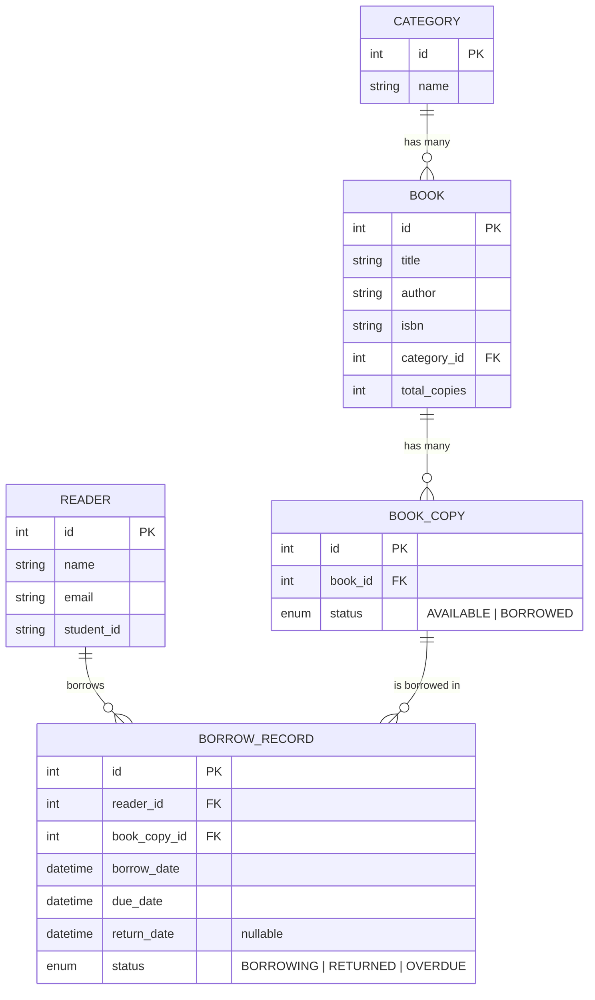
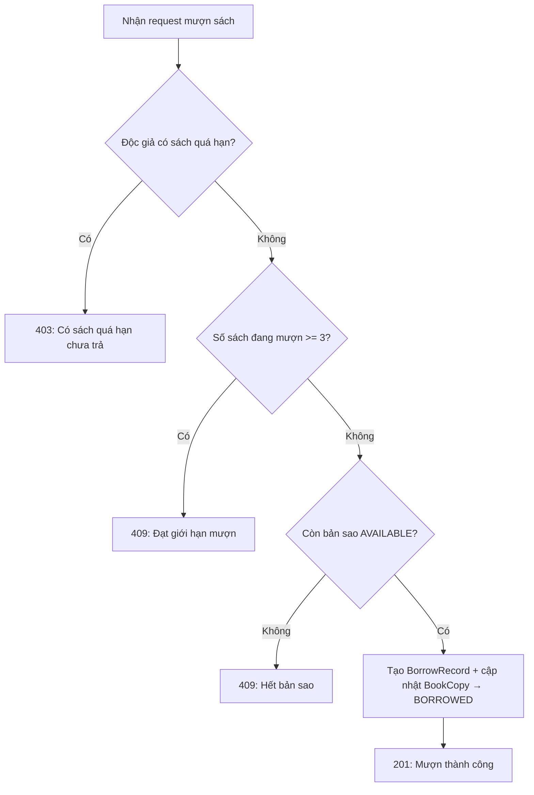
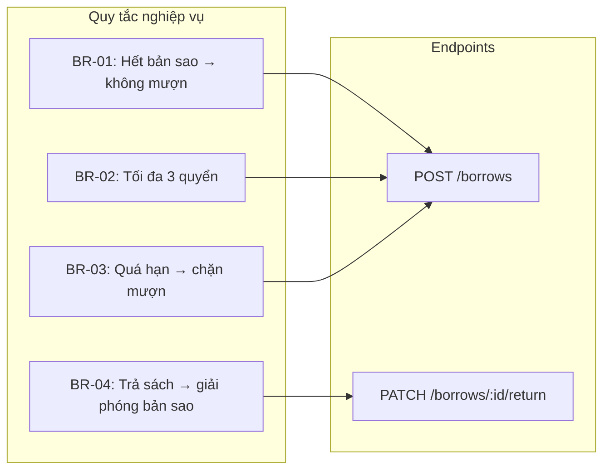

# 📚 Thiết Kế API Hệ Thống Mượn/Trả Sách — Thư Viện Đại Học

## 1. Phân Tích Nghiệp Vụ

### 1.1. Các Đối Tượng Chính (Entities)

| Đối tượng | Mô tả |
|---|---|
| **Reader** (Độc giả) | Sinh viên / giảng viên sử dụng thư viện |
| **Book** (Đầu sách) | Thông tin sách (tên, tác giả, thể loại…) |
| **BookCopy** (Bản sao) | Bản vật lý của một đầu sách, có trạng thái `AVAILABLE` / `BORROWED` |
| **BorrowRecord** (Phiếu mượn) | Ghi nhận giao dịch mượn/trả giữa độc giả và bản sao |
| **Category** (Thể loại) | Phân loại sách (Khoa học, Văn học, CNTT…) |

### 1.2. Quy Tắc Nghiệp Vụ (Business Rules)

| # | Quy tắc | Xử lý khi vi phạm |
|---|---|---|
| BR-01 | Mỗi đầu sách có **N bản sao**. Chỉ mượn được khi còn bản sao `AVAILABLE`. | Trả về `409 Conflict` — *"Sách đã hết bản sao"* |
| BR-02 | Một độc giả **không được mượn quá 3 quyển** cùng lúc. | Trả về `409 Conflict` — *"Đã đạt giới hạn mượn tối đa"* |
| BR-03 | Độc giả **đang có sách quá hạn** chưa trả → **không được mượn thêm**. | Trả về `403 Forbidden` — *"Có sách quá hạn chưa trả"* |
| BR-04 | Khi trả sách, bản sao được chuyển về `AVAILABLE`, phiếu mượn đánh dấu `RETURNED`. | — |

### 1.3. Sơ Đồ Quan Hệ (ERD)



---

## 2. Thiết Kế API (RESTful)

> [!NOTE]
> Base URL: `https://api.library.university.edu/v1`
> Authentication: Bearer Token (JWT)
> Content-Type: `application/json`

---

### 2.1. 📖 Sách & Thể Loại

#### `GET /categories` — Lấy danh sách thể loại

**Response `200 OK`:**
```json
{
  "data": [
    { "id": 1, "name": "Khoa học máy tính" },
    { "id": 2, "name": "Văn học" },
    { "id": 3, "name": "Kinh tế" }
  ]
}
```

---

#### `GET /books` — Lấy danh sách sách (có lọc & phân trang)

**Query Parameters:**

| Param | Kiểu | Bắt buộc | Mô tả |
|---|---|---|---|
| `category_id` | int | ❌ | Lọc theo thể loại |
| `search` | string | ❌ | Tìm theo tên sách / tác giả |
| `page` | int | ❌ | Trang hiện tại (mặc định: 1) |
| `limit` | int | ❌ | Số lượng / trang (mặc định: 20, tối đa: 50) |

**Response `200 OK`:**
```json
{
  "data": [
    {
      "id": 1,
      "title": "Cấu trúc dữ liệu và giải thuật",
      "author": "Nguyễn Văn A",
      "isbn": "978-604-xxx-xxx",
      "category": {
        "id": 1,
        "name": "Khoa học máy tính"
      },
      "total_copies": 5,
      "available_copies": 3
    }
  ],
  "pagination": {
    "page": 1,
    "limit": 20,
    "total_items": 150,
    "total_pages": 8
  }
}
```

---

#### `GET /books/:id` — Xem chi tiết một đầu sách

**Response `200 OK`:**
```json
{
  "data": {
    "id": 1,
    "title": "Cấu trúc dữ liệu và giải thuật",
    "author": "Nguyễn Văn A",
    "isbn": "978-604-xxx-xxx",
    "category": {
      "id": 1,
      "name": "Khoa học máy tính"
    },
    "total_copies": 5,
    "available_copies": 3,
    "description": "Giáo trình cơ bản về cấu trúc dữ liệu..."
  }
}
```

---

### 2.2. 📋 Mượn Sách

#### `POST /borrows` — Mượn sách

> [!IMPORTANT]
> Endpoint này thực thi 3 quy tắc nghiệp vụ cùng lúc: **BR-01**, **BR-02**, **BR-03**.

**Request Body:**
```json
{
  "book_id": 1
}
```

**Xử lý phía Server (Flow):**



**Response `201 Created`:**
```json
{
  "data": {
    "id": 101,
    "book": {
      "id": 1,
      "title": "Cấu trúc dữ liệu và giải thuật"
    },
    "book_copy_id": 3,
    "borrow_date": "2026-09-22T10:30:00+07:00",
    "due_date": "2026-10-06T23:59:59+07:00",
    "status": "BORROWING"
  },
  "message": "Mượn sách thành công. Hạn trả: 06/10/2026."
}
```

**Các Response Lỗi:**

| Status | Điều kiện | Body mẫu |
|---|---|---|
| `403 Forbidden` | Có sách quá hạn (BR-03) | `{ "error": "OVERDUE_BOOKS_EXIST", "message": "Bạn đang có sách quá hạn. Vui lòng trả sách trước khi mượn thêm." }` |
| `409 Conflict` | Đã mượn 3 sách (BR-02) | `{ "error": "BORROW_LIMIT_REACHED", "message": "Bạn đã mượn tối đa 3 quyển sách." }` |
| `409 Conflict` | Hết bản sao (BR-01) | `{ "error": "NO_COPIES_AVAILABLE", "message": "Sách này hiện đã hết bản sao." }` |
| `404 Not Found` | `book_id` không tồn tại | `{ "error": "BOOK_NOT_FOUND", "message": "Không tìm thấy sách." }` |

---

### 2.3. 📚 Xem Sách Đang Mượn

#### `GET /readers/me/borrows` — Xem danh sách sách đang mượn

**Query Parameters:**

| Param | Kiểu | Bắt buộc | Mô tả |
|---|---|---|---|
| `status` | string | ❌ | Lọc theo trạng thái: `BORROWING`, `RETURNED`, `OVERDUE` (mặc định: tất cả) |

**Response `200 OK`:**
```json
{
  "data": [
    {
      "id": 101,
      "book": {
        "id": 1,
        "title": "Cấu trúc dữ liệu và giải thuật",
        "author": "Nguyễn Văn A"
      },
      "book_copy_id": 3,
      "borrow_date": "2026-09-10T08:00:00+07:00",
      "due_date": "2026-09-24T23:59:59+07:00",
      "return_date": null,
      "status": "BORROWING",
      "is_overdue": false
    },
    {
      "id": 98,
      "book": {
        "id": 5,
        "title": "Kinh tế vĩ mô",
        "author": "Trần Thị B"
      },
      "book_copy_id": 12,
      "borrow_date": "2026-08-01T08:00:00+07:00",
      "due_date": "2026-08-15T23:59:59+07:00",
      "return_date": null,
      "status": "OVERDUE",
      "is_overdue": true
    }
  ],
  "summary": {
    "total_borrowing": 2,
    "total_overdue": 1,
    "remaining_quota": 1
  }
}
```

---

### 2.4. 🔄 Trả Sách

#### `PATCH /borrows/:id/return` — Trả sách

**Xử lý phía Server:**
1. Tìm `BorrowRecord` theo `id`, kiểm tra thuộc về độc giả hiện tại.
2. Kiểm tra trạng thái phải là `BORROWING` hoặc `OVERDUE`.
3. Cập nhật `BorrowRecord`: `return_date = now()`, `status = RETURNED`.
4. Cập nhật `BookCopy`: `status = AVAILABLE`.

**Response `200 OK`:**
```json
{
  "data": {
    "id": 101,
    "book": {
      "id": 1,
      "title": "Cấu trúc dữ liệu và giải thuật"
    },
    "borrow_date": "2026-09-10T08:00:00+07:00",
    "due_date": "2026-09-24T23:59:59+07:00",
    "return_date": "2026-09-22T10:35:00+07:00",
    "status": "RETURNED",
    "was_overdue": false
  },
  "message": "Trả sách thành công."
}
```

**Các Response Lỗi:**

| Status | Điều kiện | Body mẫu |
|---|---|---|
| `404 Not Found` | Không tìm thấy phiếu mượn | `{ "error": "BORROW_RECORD_NOT_FOUND" }` |
| `400 Bad Request` | Sách đã được trả rồi | `{ "error": "ALREADY_RETURNED", "message": "Sách này đã được trả trước đó." }` |
| `403 Forbidden` | Phiếu mượn không thuộc về độc giả hiện tại | `{ "error": "FORBIDDEN" }` |

---

## 3. Tổng Hợp Endpoints

| # | Method | Endpoint | Mô tả | Auth |
|---|---|---|---|---|
| 1 | `GET` | `/categories` | Danh sách thể loại | ❌ |
| 2 | `GET` | `/books` | Danh sách sách (lọc, tìm, phân trang) | ❌ |
| 3 | `GET` | `/books/:id` | Chi tiết một đầu sách | ❌ |
| 4 | `POST` | `/borrows` | Mượn sách | ✅ |
| 5 | `GET` | `/readers/me/borrows` | Xem sách đang mượn của bản thân | ✅ |
| 6 | `PATCH` | `/borrows/:id/return` | Trả sách | ✅ |

---

## 4. Quy Tắc Nghiệp Vụ ↔ Endpoint Mapping



---

## 5. HTTP Status Codes Sử Dụng

| Status Code | Ý nghĩa trong hệ thống |
|---|---|
| `200 OK` | Thao tác thành công (GET, PATCH) |
| `201 Created` | Tạo phiếu mượn thành công |
| `400 Bad Request` | Dữ liệu đầu vào không hợp lệ / sách đã trả rồi |
| `401 Unauthorized` | Chưa đăng nhập |
| `403 Forbidden` | Bị chặn do quá hạn / không có quyền |
| `404 Not Found` | Không tìm thấy tài nguyên |
| `409 Conflict` | Vi phạm ràng buộc nghiệp vụ (hết sách, quá giới hạn) |
| `500 Internal Server Error` | Lỗi hệ thống |

---

## 6. Ghi Chú Kỹ Thuật

> [!TIP]
> **Concurrency:** Khi mượn sách, nên sử dụng **pessimistic locking** hoặc **optimistic locking** trên bảng `BookCopy` để tránh race condition khi nhiều người mượn cùng bản sao.

> [!TIP]
> **Cron Job:** Nên có scheduled task chạy hàng ngày để tự động cập nhật trạng thái `OVERDUE` cho các phiếu mượn quá `due_date` mà chưa trả.

> [!NOTE]
> **Hạn mượn mặc định:** 14 ngày kể từ ngày mượn. Có thể cấu hình qua biến môi trường `BORROW_DURATION_DAYS`.

> [!NOTE]
> **Mở rộng tương lai:** Có thể thêm tính năng gia hạn (`PATCH /borrows/:id/renew`), đặt trước (`POST /books/:id/reserve`), phạt trễ hạn, thông báo email trước ngày hết hạn.
