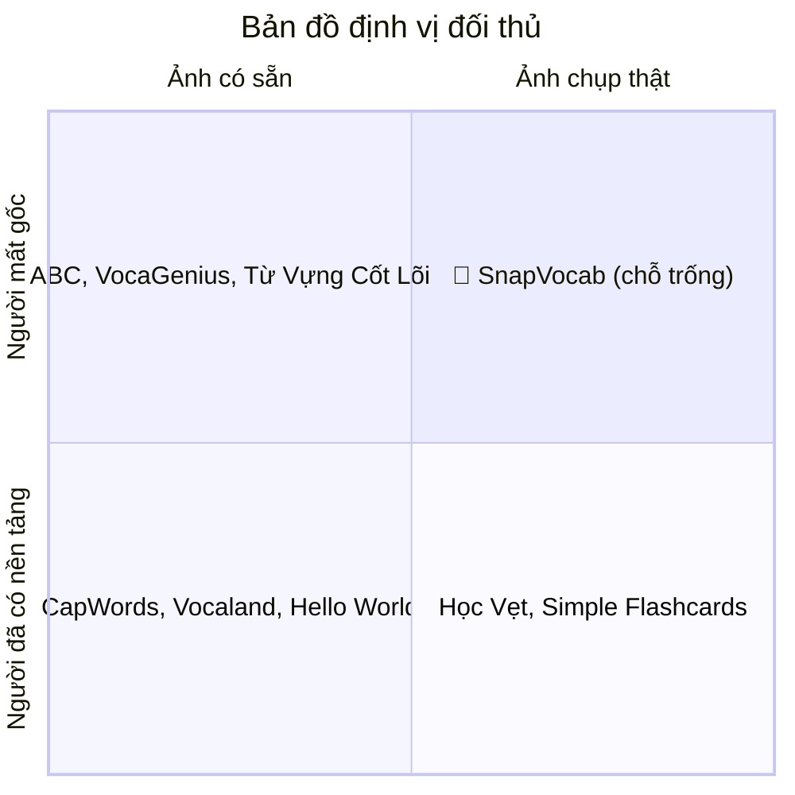
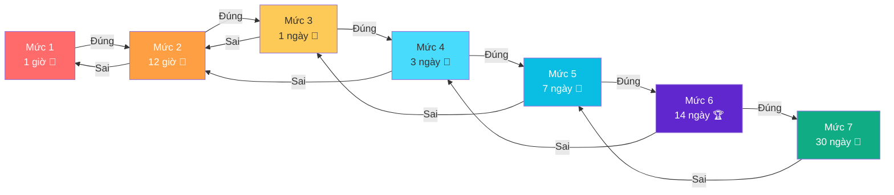

# SnapVocab — Phân Tích Thị Trường & Lợi Thế Cạnh Tranh

> **Dự án:** SnapVocab
> **Định vị:** App học từ vựng tiếng Anh qua ảnh chụp vật thật — dành riêng cho người mất gốc, học lại từ đầu
> **Ngày phân tích:** 22/09/2026

---

## 1. Bối Cảnh Thị Trường

Thị trường app học từ vựng tiếng Anh qua hình ảnh (photo-based vocabulary) đang phát triển mạnh trên toàn cầu lẫn tại Việt Nam. Duolingo ghi nhận **tăng trưởng 67% người dùng hoạt động tại Việt Nam** trong giai đoạn 2021–2022, cho thấy nhu cầu học tiếng Anh qua app vẫn đang mở rộng và còn đủ chỗ cho sản phẩm ngách mới.

Tuy nhiên, **chưa có app nào định vị rõ ràng cho phân khúc "người mất gốc"** — những người cần xây lại nền tảng từ vựng cơ bản từ chính đồ vật xung quanh mình.

---

## 2. Phân Tích Đối Thủ

### 2.1 Đối Thủ Quốc Tế (Photo-Based Vocabulary)

| App                               | Mô tả chính                                                                    | Đối tượng                                              | Điểm mạnh                                             | Gap / Điểm yếu                                                                                     |
| --------------------------------- | --------------------------------------------------------------------------------- | ---------------------------------------------------------- | -------------------------------------------------------- | ----------------------------------------------------------------------------------------------------- |
| **CapWords**                | Chụp từ đời thực → flashcard thông minh, nhận diện AI, spaced repetition | Sinh viên, du lịch, đọc sách, ôn thi GRE/TOEFL/IELTS | AI nhận diện mạnh, spaced repetition tốt             | ❌ Nhắm người**đã có nền tảng**, không phải người mất gốc                         |
| **Hello World: Vocabulary** | Dùng ảnh cá nhân tạo quiz, 9 ngôn ngữ, xử lý on-device                   | Người học đa ngôn ngữ                                | Bảo mật cao (on-device), đa ngôn ngữ                | ❌ Dùng**thư viện ảnh có sẵn** (không chụp trực tiếp), không định vị cho beginner |
| **Vocaland**                | Ảnh chụp/screenshot → từ vựng kèm dịch, "10 phút/ngày"                   | Người học tổng quát                                   | Đã có doanh thu thật (~**$17k MRR**), UX đơn giản | ❌ App**tổng quát**, không phân khúc theo trình độ                                      |
| **OpenWords**               | Học từ vựng đa nghĩa, không quảng cáo, không ép subscription            | Người chán các app truyền thống                      | Giải quyết 3 nỗi đau thị trường (xem mục 3)      | ❌ Không có tính năng photo-based                                                                 |

### 2.2 Đối Thủ Tại Việt Nam

| App                                    | Nhà phát triển             | Mô tả chính                                                                                                     | Điểm mạnh                                                                             | Gap / Điểm yếu                                                                                        |
| -------------------------------------- | ----------------------------- | ------------------------------------------------------------------------------------------------------------------ | ---------------------------------------------------------------------------------------- | -------------------------------------------------------------------------------------------------------- |
| **Học Vẹt**                    | X-Team (IELTS 8.5, TOEIC 990) | Hệ sinh thái học giao tiếp; tính năng chụp ảnh nhận diện từ vựng ở bản 3.1                           | Brand uy tín, hệ sinh thái phong phú (thi đấu, khóa học)                         | ❌ Chụp ảnh chỉ là**tính năng phụ**, không phải trải nghiệm trung tâm                  |
| **Simple Flashcards**            | VAN LANG TECHNOLOGIES         | Tạo flashcard từ danh sách/ảnh, tự sinh định nghĩa, IPA, từ loại, ví dụ; từ điển Anh-Việt, offline | Offline hoàn toàn, không cần tài khoản,**đối thủ trực tiếp gần nhất** | ❌ Định vị**"công cụ tạo flashcard" chung chung**, không đóng khung cho người mất gốc |
| **VocaGenius**                   | —                            | Học từ vựng qua hình ảnh/chủ đề có sẵn                                                                   | Giao diện thân thiện, phân loại theo chủ đề                                      | ❌ Dùng**ảnh minh hoạ có sẵn**, không phải ảnh vật thật của người dùng               |
| **Từ Vựng Cốt Lõi**          | —                            | Từ vựng cơ bản theo chủ đề                                                                                  | Nội dung cốt lõi, dễ tiếp cận                                                      | ❌ Ảnh có sẵn, không gắn ngữ cảnh thật                                                           |
| **Học tiếng Anh cơ bản ABC** | —                            | Từ vựng cơ bản qua hình ảnh chủ đề (nhà bếp, gia đình...)                                             | Đơn giản, dễ dùng cho beginner                                                      | ❌ Ảnh minh hoạ theo chủ đề,**không phải ảnh do người dùng chụp**                      |

---

## 3. Ba Nỗi Đau Thị Trường (Insight từ OpenWords)

> [!IMPORTANT]
> Đây là 3 vấn đề mà founder OpenWords đã chỉ ra trực tiếp — và chính là 3 điểm SnapVocab có thể khai thác.

| # | Nỗi đau                                           | Mô tả                                                                        | Cách SnapVocab giải quyết                                                                |
| - | --------------------------------------------------- | ------------------------------------------------------------------------------ | ------------------------------------------------------------------------------------------- |
| 1 | **Subscription ép buộc**                    | Các app đẩy mạnh gói thuê bao theo năm, gây áp lực tài chính       | Gói**free đủ dùng** cho nhu cầu cơ bản; premium chỉ cho tính năng nâng cao |
| 2 | **1 từ = 1 nghĩa + quảng cáo dày đặc** | Từ vựng thực tế có nhiều nghĩa, nhưng app chỉ dịch 1 nghĩa kèm ads | Hiển thị**đa nghĩa theo ngữ cảnh**, trải nghiệm sạch quảng cáo             |
| 3 | **Anki quá thủ công**                      | Tạo flashcard thủ công trên Anki rất mất thời gian, khó duy trì       | Chụp ảnh →**tự động tạo flashcard** bằng AI, zero effort                      |

---

## 4. Market Gap — Phân Khúc Bỏ Trống

> [!TIP]
> **Góc phần tư trên-phải (người mất gốc + ảnh chụp thật) đang hoàn toàn trống** — đây chính là vị trí mà SnapVocab sẽ chiếm lĩnh.

### 4 Gap Cụ Thể Có Thể Khai Thác

| #  | Gap                                          | Chi tiết                                                                                                                                                                                                                                        |
| -- | -------------------------------------------- | ------------------------------------------------------------------------------------------------------------------------------------------------------------------------------------------------------------------------------------------------ |
| 🎯 | **Phân khúc bỏ trống**             | Chưa app nào định vị rõ ràng*"dành cho người mất gốc, học lại từ vựng cơ bản từ chính đồ vật quanh mình"*. Tất cả app photo-vocab hiện có đều nhắm người đã có nền (test prep, du lịch, chuyên ngành). |
| 📸 | **Ngữ cảnh thật > ảnh có sẵn**   | Các app Việt cho beginner (VocaGenius, ABC...) dùng ảnh minh hoạ theo chủ đề — mất đi lợi thế*"học từ đúng vật mình đang cầm/nhìn thấy"*. CapWords/Vocaland có ảnh thật nhưng nhắm sai phân khúc.                |
| 💰 | **Mô hình kinh doanh thân thiện**  | Subscription ép năm + ads dày đặc gây khó chịu. Gói free đủ dùng cho target mất gốc (ít nhu cầu phức tạp) sẽ dễ chiếm cảm tình.                                                                                           |
| 📈 | **Thị trường đang tăng trưởng** | +67% người dùng Duolingo tại VN (2021–2022). Nhu cầu học tiếng Anh qua app vẫn mở rộng, đủ chỗ cho sản phẩm ngách.                                                                                                              |

---

## 5. Lợi Thế Cạnh Tranh Của SnapVocab

> [!NOTE]
> SnapVocab không cạnh tranh trực tiếp với các app lớn — mà **chiếm lĩnh một phân khúc chưa ai phục vụ**.

### So sánh trực tiếp

| Tiêu chí                | CapWords | Vocaland | Simple Flashcards | App VN (ABC, VocaGenius) | **SnapVocab** |
| ------------------------- | -------- | -------- | ----------------- | ------------------------ | ------------------- |
| Chụp ảnh vật thật     | ✅       | ✅       | ✅                | ❌                       | ✅                  |
| Nhắm người mất gốc   | ❌       | ❌       | ❌                | ⚠️ Một phần          | ✅                  |
| Giao diện Tiếng Việt   | ❌       | ❌       | ✅                | ✅                       | ✅                  |
| Giải thích đa nghĩa   | ❌       | ❌       | ⚠️              | ❌                       | ✅                  |
| Free đủ dùng cơ bản  | ❌       | ❌       | ✅                | ⚠️                     | ✅                  |
| Spaced repetition         | ✅       | ❌       | ❌                | ❌                       | ✅                  |
| Học từ ngữ cảnh thật | ✅       | ✅       | ⚠️              | ❌                       | ✅                  |

### Tóm tắt lợi thế cốt lõi

1. **Đúng người — Đúng nhu cầu:** Duy nhất trên thị trường định vị cho người mất gốc cần xây lại từ vựng từ đầu
2. **Học từ đời thật:** Chụp ảnh vật xung quanh → AI nhận diện → flashcard tự động — từ vựng gắn với ngữ cảnh sống thật
3. **Đa nghĩa theo ngữ cảnh:** Không chỉ dịch 1 nghĩa, mà giải thích từ vựng theo nhiều ngữ cảnh sử dụng
4. **Giao diện & giải thích bằng tiếng Việt:** Thân thiện hoàn toàn với người Việt mất gốc tiếng Anh
5. **Mô hình kinh doanh fair:** Gói free đủ cho nhu cầu cơ bản, không ép subscription, không ads xâm lấn
6. **Spaced repetition thông minh:** Ôn tập khoa học để nhớ lâu, nhưng tự động hoá thay vì thủ công như Anki

---

## 5.1 Hệ Thống Ôn Tập Spaced Repetition — 7 Mức Độ

> [!NOTE]
> Dựa trên **đường cong quên lãng Ebbinghaus** và thuật toán SM-2 (SuperMemo). Khoảng cách ôn tập tăng dần theo cấp số nhân — đúng thời điểm não sắp quên thì nhắc lại, giúp chuyển từ bộ nhớ ngắn hạn sang dài hạn hiệu quả nhất.

### Bảng mức độ ôn tập

| Mức độ                        | Khoảng cách ôn tập | Thời điểm nhắc lại      | Trạng thái ghi nhớ                    | Biểu tượng |
| -------------------------------- | ---------------------- | ---------------------------- | ---------------------------------------- | ------------- |
| **Mức 1** — Mới học    | **1 giờ**       | Ngay trong buổi học        | 🔴 Rất dễ quên — cần củng cố ngay | 🌱            |
| **Mức 2** — Nhận biết  | **12 giờ**      | Cuối ngày / sáng hôm sau | 🟠 Đã nhận ra nhưng chưa chắc      | 🌿            |
| **Mức 3** — Quen mặt    | **1 ngày**      | Ngày hôm sau               | 🟡 Bắt đầu quen, cần nhắc thêm     | 🌳            |
| **Mức 4** — Nhớ được | **3 ngày**      | Sau 3 ngày                  | 🟢 Nhớ được khi gợi ý              | 🌲            |
| **Mức 5** — Nhớ tốt    | **7 ngày**      | Sau 1 tuần                  | 🔵 Nhớ tốt, ít cần gợi ý           | 💪            |
| **Mức 6** — Thuộc       | **14 ngày**     | Sau 2 tuần                  | 🟣 Gần như thuộc lòng                | 🏆            |
| **Mức 7** — Thành thạo | **30 ngày**     | Sau 1 tháng                 | ⭐ Đã vào bộ nhớ dài hạn          | 👑            |

### Cơ chế thăng / giáng cấp

### Quy tắc hoạt động

| Quy tắc                       | Mô tả                                                                                 |
| ------------------------------ | --------------------------------------------------------------------------------------- |
| ✅**Trả lời đúng**   | Từ vựng**lên 1 mức** → khoảng cách ôn tập dài hơn                      |
| ❌**Trả lời sai**      | Từ vựng**tụt 1–2 mức** (tuỳ mức hiện tại) → ôn lại sớm hơn          |
| 🔄**Quá hạn ôn tập** | Nếu quá hạn mà vẫn nhớ đúng → vẫn lên mức. Nếu sai → tụt mức nặng hơn |
| 👑**Đạt Mức 7**       | Từ được đánh dấu "Thành thạo" — chỉ ôn lại mỗi 30 ngày để duy trì     |
| 🌱**Từ mới chụp**     | Luôn bắt đầu ở**Mức 1** — nhắc lại sau 1 giờ                            |

### Ví dụ thực tế cho người mất gốc

> Bạn chụp ảnh **cái ly nước** → AI nhận diện → flashcard `glass / glæs / — cái ly`
>
> | Thời điểm | Hành động                                     | Kết quả                                  |
> | ------------ | ------------------------------------------------ | ------------------------------------------ |
> | 10:00 sáng  | Chụp ảnh cái ly → Mức 1                     | 🌱 Từ mới, nhắc lại lúc 11:00         |
> | 11:00 sáng  | Quiz: "Cái ly = ?" → Trả lời đúng`glass` | ✅ Lên Mức 2, nhắc lại lúc 23:00      |
> | 23:00 tối   | Quiz: nhìn ảnh cái ly → Trả lời đúng     | ✅ Lên Mức 3, nhắc lại ngày mai       |
> | Ngày +1     | Quiz → Trả lời đúng                         | ✅ Lên Mức 4, nhắc lại sau 3 ngày     |
> | Ngày +4     | Quiz → Trả lời**sai**                   | ❌ Tụt về Mức 2, nhắc lại sau 12 giờ |
> | ...          | Tiếp tục ôn                                   | 🔄 Từ từ leo lại lên Mức 7            |

> [!TIP]
> **Tại sao hệ thống này phù hợp với người mất gốc?**
>
> - Khoảng cách ôn **ngắn ở giai đoạn đầu** (1h, 12h) — phù hợp người cần lặp lại nhiều
> - **Tự động hoàn toàn** — không cần tự sắp xếp lịch ôn như Anki
> - **Không áp lực** — trả lời sai thì ôn lại, không bị phạt hay mất streak
> - Biểu tượng trực quan (🌱→👑) giúp người học **thấy rõ tiến trình** của mình

---

## 6. Nguồn Tham Khảo

| Nguồn                                  | Nội dung                                                           |
| --------------------------------------- | ------------------------------------------------------------------- |
| App Store — CapWords                   | Trang sản phẩm, mô tả tính năng & đối tượng               |
| App Store — Hello World: Vocabulary    | Trang sản phẩm, tính năng on-device                             |
| App Store — Học Vẹt                  | Trang sản phẩm, changelog bản 3.1                                |
| App Store — Simple Flashcards          | Trang sản phẩm VAN LANG TECHNOLOGIES                              |
| App Store — VocaGenius                 | Trang sản phẩm                                                    |
| LinkedIn — OpenWords founder interview | 3 vấn đề thị trường (subscription, 1-nghĩa, Anki thủ công) |
| trustmrr.com — Vocaland                | Phân tích doanh thu (~$17k MRR)                                   |
| brandsvietnam.com                       | Thị trường app học tiếng Anh tại VN, số liệu Duolingo +67%  |

---

> [!CAUTION]
> Tài liệu này là bản phân tích nội bộ cho dự án SnapVocab. Các số liệu và thông tin được tổng hợp từ nguồn công khai tại thời điểm phân tích — cần cập nhật định kỳ khi thị trường thay đổi.
